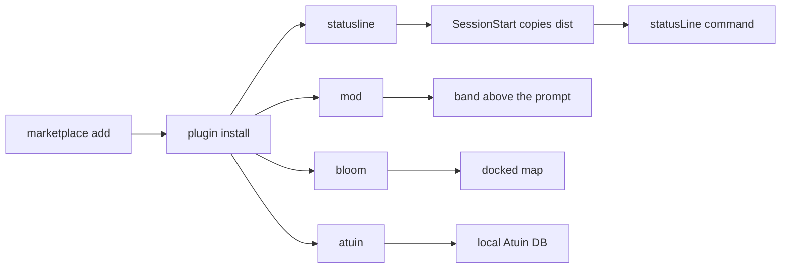

# cc-plugins

[Claude Code](https://claude.ai/code) plugins from [RetiredPhysicist](https://github.com/RetiredPhysicist), installed from one marketplace.

[](https://github.com/RetiredPhysicist/cc-plugins/actions/workflows/ci.yml)
[](#license)

[中文](./README.zh.md)

Four plugins. Two are mods that run inside the session. One is a status-line command Claude Code calls as a subprocess. One writes prompts and Bash into the local [Atuin](https://atuin.sh) database.

| Plugin | Kind | What you see |
| --- | --- | --- |
| [`cc-shannon-statusline`](./plugins/cc-shannon-statusline) | `statusLine` command | A HUD under the prompt: project, git, model, context, transcript timing, tools, agents, config counts |
| [`cc-shannon-mod`](./plugins/cc-shannon-mod) | mod | The same HUD, plus measured turn timing, a risky-command guard, a usage ledger, a prompt queue, and a context runway |
| [`cc-shannon-bloom`](./plugins/cc-shannon-bloom) | mod | A live map of the session: projects as hubs, subagents as branches, tool calls as sparks |
| [`cc-atuin`](./plugins/cc-atuin) | mod | Prompts and Bash commands written into Atuin, searched with `/history` |

`cc-shannon-statusline` and `cc-shannon-mod` overlap on purpose and do not conflict. The statusline receives a JSON snapshot and rebuilds activity from the transcript, so its speed numbers are estimates. The mod sees the response stream, so its timing is measured, and it can draw UI and stop a command before it runs. Install either or both.



## Install

```bash
claude plugin marketplace add RetiredPhysicist/cc-plugins
claude plugin install cc-shannon-statusline@cc-plugins
claude plugin install cc-shannon-mod@cc-plugins
claude plugin install cc-shannon-bloom@cc-plugins
claude plugin install cc-atuin@cc-plugins
```

Or add the marketplace once and install from `/plugin` inside a session.

Restart Claude Code, or run `/reload-plugins`. The statusline appears on the next session start: its `SessionStart` hook copies the committed build to `~/.shannon/cc-shannon-statusline/` and points `statusLine` in `~/.claude/settings.json` at `~/.shannon/cc-shannon-statusline/run.sh`. A `statusLine` you already set to something else is left alone.

Per-plugin requirements, commands, and config are in each plugin README.

## Commands

| Plugin | Command | Does |
| --- | --- | --- |
| cc-shannon-mod | `/shannon` | Open the detail pane |
| cc-shannon-mod | `/shannon-guard` | Turn the risky-command guard on or off |
| cc-shannon-mod | `/shannon-rain` | Turn the matrix rain on or off |
| cc-shannon-mod | `/shannon-toggle <name>` | Toggle `companion`, `lens`, `queue`, `latency`, or `notify` |
| cc-shannon-mod | `/q <text>` | Queue a prompt for the end of the current turn |
| cc-shannon-mod | `/shannon-queue` | List, reorder, or drop queued prompts |
| cc-shannon-bloom | `/bloom` | Open the map |
| cc-shannon-bloom | `/bloom-toggle` | Open the map; reports when it is already open |
| cc-atuin | `/history` | Search Atuin and fill the prompt |
| cc-shannon-statusline | `/cc-shannon-statusline:setup` | Re-run the statusline install |

## Requirements

| Plugin | Needs |
| --- | --- |
| cc-shannon-statusline | Node.js 22 or later on `PATH`. The install hook resolves `node` and writes that path into `run.sh`. |
| cc-shannon-mod | Claude Code 2.1.287 or later. Native guard notifications need 2.1.295, and stay off unless `notify` is set. |
| cc-shannon-bloom | Claude Code 2.1.287 or later, and a terminal surface that can place a pane. |
| cc-atuin | Claude Code 2.1.287 or later, and `atuin` on `PATH`. |

None of the four plugins makes a network request of its own. cc-shannon-statusline writes session data to a local Unix socket when a consumer is listening. Atuin may reach the network, if you configured sync on that binary.

## Update

```bash
claude plugin update cc-shannon-statusline@cc-plugins
claude plugin update cc-shannon-mod@cc-plugins
claude plugin update cc-shannon-bloom@cc-plugins
claude plugin update cc-atuin@cc-plugins
```

Then restart Claude Code, or run `/reload-plugins`. Plugins here omit `version` on purpose. The installed version is the source commit SHA, so a push to `main` is the release.

## Layout

Each plugin is `plugins/<name>/` with a `.claude-plugin/plugin.json`. The repository root has no shared runtime. Claude Code reads the tree as-is and runs no build on install, so `cc-shannon-statusline` commits `dist/`. CI rebuilds that directory and fails when it differs from `src/`.

```text
.claude-plugin/marketplace.json
plugins/cc-shannon-statusline/   statusLine command, TypeScript, committed dist/
plugins/cc-shannon-mod/          mod, hooks/*.js
plugins/cc-shannon-bloom/        mod, hooks/*.js
plugins/cc-atuin/                mod, hooks/*.js
```

To add a plugin: create `plugins/<name>/.claude-plugin/plugin.json`, add an entry under `plugins` in [`.claude-plugin/marketplace.json`](./.claude-plugin/marketplace.json), keep it self-contained, and commit any build the install needs.

## Development

```bash
git clone https://github.com/RetiredPhysicist/cc-plugins.git
cd cc-plugins
```

| Plugin | Check |
| --- | --- |
| cc-shannon-statusline | `bun install && bun test && bun run build` in `plugins/cc-shannon-statusline` |
| cc-shannon-mod | `node --test test/*.test.mjs` and `claude plugin test .` |
| cc-shannon-bloom | `node --test test/*.test.mjs` and `claude plugin test .` |
| cc-atuin | `node --test test/*.test.mjs` and `claude plugin test .` |

CI on `main` and on pull requests runs those checks, then `claude plugin validate` on the marketplace and each plugin. Validation is not `--strict`: the missing `version` field is intentional.

## Release

**Preferred (statusline build tooling):** [Changesets](https://github.com/changesets/changesets) for `plugins/cc-shannon-statusline` (the only directory with a `package.json`). From the repo root (after `npm ci --workspaces=false`):

```bash
npx changeset          # pick packages + bump type; commit .changeset/*.md in your PR
```

On merge to `main`, `.github/workflows/release.yml` opens a **Version Packages** PR. Merge that PR. The package is `private` — nothing is published to npm. Claude Code marketplace plugins in this repo still omit `version` on purpose; a push to `main` remains the installable revision (commit SHA). The root `package.json` is private and only exists so Changesets can discover that workspace.

There is no tag → npm `publish.yml` in this repository.

## License

MIT. Each plugin has its own `LICENSE`.

`cc-shannon-bloom` adapts the world simulation, camera, and palette from [opencode-bloom](https://github.com/kitlangton/opencode-bloom) (MIT, Kit Langton). The notice is in [`plugins/cc-shannon-bloom/LICENSE`](./plugins/cc-shannon-bloom/LICENSE).

`cc-shannon-statusline` keeps the copyright line from its earlier tree: Copyright (c) 2024 RealAlexandreAI, in [`plugins/cc-shannon-statusline/LICENSE`](./plugins/cc-shannon-statusline/LICENSE). The other three say Copyright (c) 2026 RetiredPhysicist.
