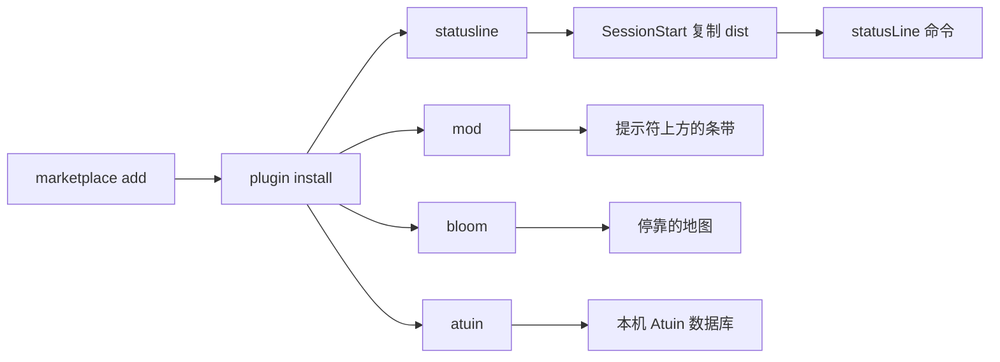

# cc-plugins

[RetiredPhysicist](https://github.com/RetiredPhysicist) 的 [Claude Code](https://claude.ai/code) 插件，从一个 marketplace 安装。

[](https://github.com/RetiredPhysicist/cc-plugins/actions/workflows/ci.yml)
[](#许可证)

[English](./README.md)

四个插件。两个是跑在会话里的 mod。一个是 Claude Code 以子进程调用的 status line 命令。一个把提示词和 Bash 写进本机的 [Atuin](https://atuin.sh) 数据库。

| 插件 | 类型 | 你看到的 |
| --- | --- | --- |
| [`cc-shannon-statusline`](./plugins/cc-shannon-statusline) | `statusLine` 命令 | 提示符下方的 HUD：项目、git、模型、上下文、转录计时、工具、子代理、配置计数 |
| [`cc-shannon-mod`](./plugins/cc-shannon-mod) | mod | 同一套 HUD，加上实测回合计时、危险命令拦截、用量账本、提示词队列、上下文余量 |
| [`cc-shannon-bloom`](./plugins/cc-shannon-bloom) | mod | 会话的实时地图：项目是枢纽，子代理是分支，工具调用是火花 |
| [`cc-atuin`](./plugins/cc-atuin) | mod | 提示词和 Bash 写入 Atuin，用 `/history` 搜索 |

`cc-shannon-statusline` 和 `cc-shannon-mod` 故意重叠，互不冲突。statusline 收到一份 JSON 快照，再从转录重建活动，所以速度数字是估计。mod 看得到响应流，所以计时是实测，也能画界面、在命令执行前拦住它。装一个或两个都可以。



## 安装

```bash
claude plugin marketplace add RetiredPhysicist/cc-plugins
claude plugin install cc-shannon-statusline@cc-plugins
claude plugin install cc-shannon-mod@cc-plugins
claude plugin install cc-shannon-bloom@cc-plugins
claude plugin install cc-atuin@cc-plugins
```

也可以先加 marketplace，再在会话里用 `/plugin` 安装。

重启 Claude Code，或运行 `/reload-plugins`。statusline 在下一次会话开始时出现：它的 `SessionStart` 钩子把已提交的构建复制到 `~/.shannon/cc-shannon-statusline/`，并把 `~/.claude/settings.json` 里的 `statusLine` 指到 `~/.shannon/cc-shannon-statusline/run.sh`。你已经设成别的东西的 `statusLine` 不会被改。

各插件的要求、命令和配置写在各自的 README 里。

## 命令

| 插件 | 命令 | 作用 |
| --- | --- | --- |
| cc-shannon-mod | `/shannon` | 打开详情面板 |
| cc-shannon-mod | `/shannon-guard` | 开关危险命令拦截 |
| cc-shannon-mod | `/shannon-rain` | 开关矩阵雨 |
| cc-shannon-mod | `/shannon-toggle <name>` | 切换 `companion`、`lens`、`queue`、`latency` 或 `notify` |
| cc-shannon-mod | `/q <text>` | 把一条提示词排到当前回合结束 |
| cc-shannon-mod | `/shannon-queue` | 列出、重排或丢掉排队的提示词 |
| cc-shannon-bloom | `/bloom` | 打开地图 |
| cc-shannon-bloom | `/bloom-toggle` | 打开地图；已打开时如实回报 |
| cc-atuin | `/history` | 搜索 Atuin，并把选中的命令填进提示词 |
| cc-shannon-statusline | `/cc-shannon-statusline:setup` | 重新跑一遍 statusline 安装 |

## 要求

| 插件 | 需要 |
| --- | --- |
| cc-shannon-statusline | `PATH` 上有 Node.js 22 或更新。安装钩子会解析 `node`，并把那个路径写进 `run.sh`。 |
| cc-shannon-mod | Claude Code 2.1.287 或更新。原生拦截通知需要 2.1.295，并且只有设置了 `notify` 才会发出。 |
| cc-shannon-bloom | Claude Code 2.1.287 或更新，以及能放置 pane 的终端界面。 |
| cc-atuin | Claude Code 2.1.287 或更新，并且 `PATH` 上有 `atuin`。 |

四个插件自己都不发网络请求。有消费者在监听时，cc-shannon-statusline 会把会话数据写进本地 Unix socket。如果你给 Atuin 配了同步，那个二进制自己可能会联网。

## 更新

```bash
claude plugin update cc-shannon-statusline@cc-plugins
claude plugin update cc-shannon-mod@cc-plugins
claude plugin update cc-shannon-bloom@cc-plugins
claude plugin update cc-atuin@cc-plugins
```

然后重启 Claude Code，或运行 `/reload-plugins`。这里的插件故意不写 `version`。装上的版本就是源码提交的 SHA，所以推到 `main` 就是一次发布。

## 布局

每个插件是 `plugins/<name>/`，带一份 `.claude-plugin/plugin.json`。仓库根没有共享运行时。Claude Code 按仓库原样读取，安装时不构建，所以 `cc-shannon-statusline` 把 `dist/` 提交进仓库。CI 会重新构建这个目录，和 `src/` 不一致就失败。

```text
.claude-plugin/marketplace.json
plugins/cc-shannon-statusline/   statusLine 命令，TypeScript，提交 dist/
plugins/cc-shannon-mod/          mod，hooks/*.js
plugins/cc-shannon-bloom/        mod，hooks/*.js
plugins/cc-atuin/                mod，hooks/*.js
```

要加一个插件：建 `plugins/<name>/.claude-plugin/plugin.json`，在 [`.claude-plugin/marketplace.json`](./.claude-plugin/marketplace.json) 的 `plugins` 里加一条，保持自包含，并把安装需要的构建产物一起提交。

## 开发

```bash
git clone https://github.com/RetiredPhysicist/cc-plugins.git
cd cc-plugins
```

| 插件 | 检查 |
| --- | --- |
| cc-shannon-statusline | 在 `plugins/cc-shannon-statusline` 里跑 `bun install && bun test && bun run build` |
| cc-shannon-mod | `node --test test/*.test.mjs`，以及 `claude plugin test .` |
| cc-shannon-bloom | `node --test test/*.test.mjs`，以及 `claude plugin test .` |
| cc-atuin | `node --test test/*.test.mjs`，以及 `claude plugin test .` |

`main` 和 pull request 上的 CI 跑这些检查，再对 marketplace 和每个插件跑 `claude plugin validate`。校验不用 `--strict`：缺 `version` 字段是故意的。

## 许可证

MIT。每个插件有自己的 `LICENSE`。

`cc-shannon-bloom` 的世界模拟、镜头和调色改编自 [opencode-bloom](https://github.com/kitlangton/opencode-bloom)（MIT，Kit Langton）。声明在 [`plugins/cc-shannon-bloom/LICENSE`](./plugins/cc-shannon-bloom/LICENSE)。

`cc-shannon-statusline` 保留更早那棵树的版权行：Copyright (c) 2024 RealAlexandreAI，见 [`plugins/cc-shannon-statusline/LICENSE`](./plugins/cc-shannon-statusline/LICENSE)。另外三个是 Copyright (c) 2026 RetiredPhysicist。
